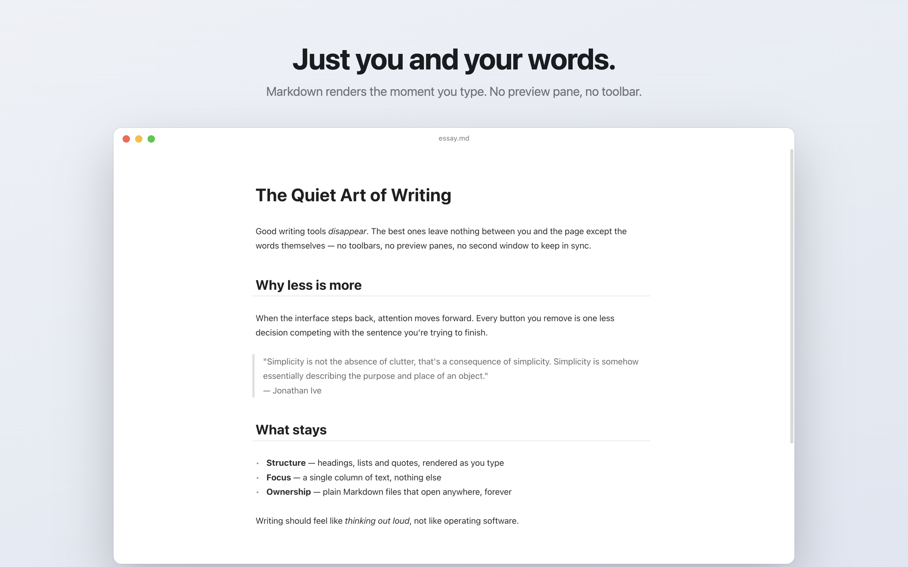
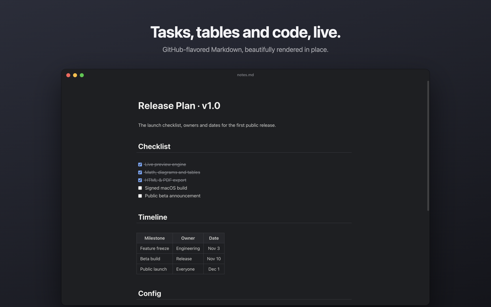
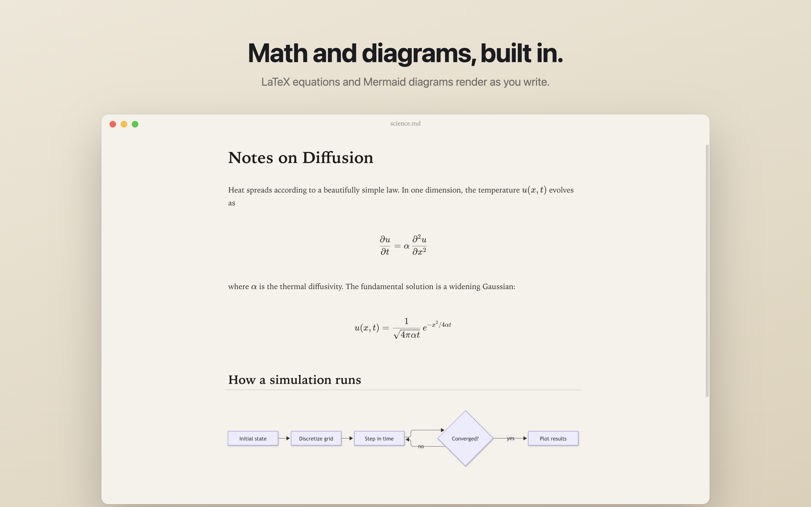
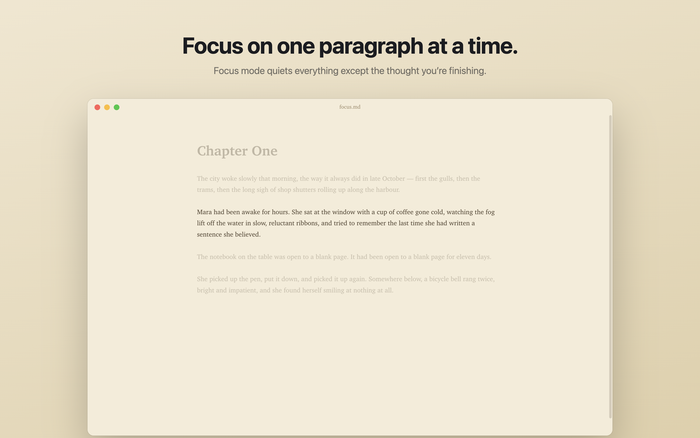
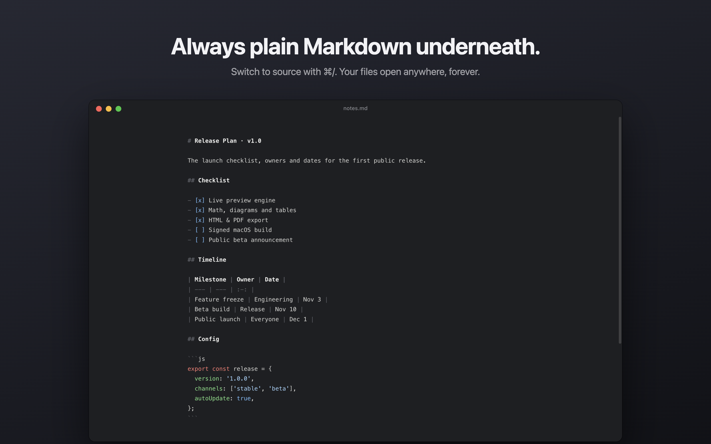

# Typewriter

A seamless live-preview Markdown editor for macOS and Windows, inspired by Typora. There is no split preview: Markdown renders in place, and its syntax appears only where the caret is.



| | |
| --- | --- |
|  |  |
|  |  |

## Download

Get the latest version from [Releases](https://github.com/Ssurajbalii/typewriter/releases/latest):

- **Mac** (Apple Silicon): `Typewriter-<version>-arm64.dmg`. See [Installing as a Mac app](#installing-as-a-mac-app).
- **Windows** (64-bit): `Typewriter-Setup-<version>-x64.exe`. See [Installing on Windows](#installing-on-windows).

Both need a one-time security step the first time you open them, because the app isn't signed with a paid certificate.

## Run from source

Requires macOS or Windows and [Node.js](https://nodejs.org) 22 or newer.

```bash
git clone <this repo> && cd Typewriter
npm install
npm start        # build the renderer and launch the app
npm run dev      # Vite dev server + Electron, with hot reload for the renderer
npm run dist     # build release/Typewriter-<version>-arm64.dmg (Apple Silicon)
```

Open a file directly with `npm start -- path/to/file.md`.

### Installing as a Mac app

`npm run dist` builds a DMG in `release/` (use `npm run dist:universal` for one that also runs on Intel Macs). Open it and drag **Typewriter** into **Applications**.

The app is ad-hoc signed, so it needs no Apple Developer account. A DMG you build yourself opens normally. A downloaded one is blocked the first time, because it isn't notarized by Apple:

1. Open Typewriter once. macOS says it can't verify the app; click **Done**.
2. Go to **System Settings → Privacy & Security**, scroll down, and click **Open Anyway** next to Typewriter.
3. Confirm with **Open Anyway** again. From then on it opens normally.

If macOS instead says the app "is damaged", run `xattr -dr com.apple.quarantine /Applications/Typewriter.app` in Terminal, then open it again.

### Installing on Windows

`npm run dist:win` builds `release/Typewriter-Setup-<version>-x64.exe` (on Windows; building the installer on a Mac needs Rosetta). Run it and follow the installer.

Windows SmartScreen shows **"Windows protected your PC"** the first time. Click **More info**, then **Run anyway**. You only need to do this once.

### Using an AI coding agent

Agents can install, run and change Typewriter on their own. Point yours at this repo, for example *"Clone github.com/Ssurajbalii/typewriter, set it up and run it."* Setup, verification and architecture notes for agents are in [`AGENTS.md`](AGENTS.md), which Codex, Cursor, Copilot and Gemini CLI read automatically. Claude Code reads it through [`CLAUDE.md`](CLAUDE.md).

## Features

- **Tabs that never lose work**: open as many documents as you like (⌘T new tab, ⌘W close, Ctrl+Tab switch). Like Notepad++, you never have to save. Every tab, including untitled drafts and unsaved edits, comes back exactly as you left it the next time you open the app, with the same text, cursor and scroll position.
- **Live preview**: headings, emphasis, strikethrough, `==highlight==`, inline code, links, images, blockquotes, lists and task lists (with clickable checkboxes), horizontal rules
- **Rich blocks**: KaTeX math (`$…$`, `$$…$$`), Mermaid diagrams, GFM tables and syntax-highlighted code fences. Click any of them to edit its source.
- **Modes**: source code mode (⌘/), focus mode (F8), typewriter mode (F9)
- **Sidebar**: live outline and a folder file tree (⇧⌘L)
- **Themes**: GitHub, Newsprint, Night, Pixyll, Whitey and Gothic (the looks of Typora's bundled themes, recreated from scratch), plus Paper and Sepia. Follows the system appearance until you pick one. Fonts are bundled, so themes look the same on every computer.
- **Export**: standalone HTML and PDF. Math is exported as MathML and diagrams as inline SVG.
- Word/character count and reading time, find & replace, drag-and-drop files and images, recent documents, unsaved-changes prompts

## Commands and shortcuts

Every command is also in the menu bar. On Windows the menu bar is hidden until you press **Alt**.

### Files and tabs

| Command | Mac | Windows |
| --- | --- | --- |
| New tab | ⌘T or ⌘N | Ctrl+T or Ctrl+N |
| Open file | ⌘O | Ctrl+O |
| Open folder (sidebar file browser) | ⇧⌘O | Ctrl+Shift+O |
| Save | ⌘S | Ctrl+S |
| Save as | ⇧⌘S | Ctrl+Shift+S |
| Close tab | ⌘W | Ctrl+W |
| Close all tabs | ⌥⌘W | Ctrl+Alt+W |
| Reopen closed tab | ⇧⌘T | Ctrl+Shift+T |
| Close window | ⇧⌘W | Ctrl+Shift+W |
| Next / previous tab | Ctrl+Tab / Ctrl+⇧Tab | Ctrl+Tab / Ctrl+Shift+Tab |
| Export to HTML or PDF | File → Export | File → Export |

You never have to save. Tabs, including unsaved drafts, are restored the next time you open the app.

**Right-click a tab** for: Close, Close Others, Close Tabs to the Left, Close Tabs to the Right, Close Saved Tabs, Close All, Copy File Path, Reveal in Finder (Show in Explorer on Windows) and Reopen Closed Tab. **Drag tabs** to reorder them. Reopen Closed Tab also brings back text you closed with "Don't Save".

### Editing

| Command | Mac | Windows |
| --- | --- | --- |
| Undo / redo | ⌘Z / ⇧⌘Z | Ctrl+Z / Ctrl+Y |
| Cut / copy / paste | ⌘X / ⌘C / ⌘V | Ctrl+X / Ctrl+C / Ctrl+V |
| Paste as plain text | ⇧⌘V | Ctrl+Shift+V |
| Select all | ⌘A | Ctrl+A |
| Find | ⌘F | Ctrl+F |
| Find and replace | ⌥⌘F | Ctrl+Alt+F |
| Indent / outdent | Tab / ⇧Tab | Tab / Shift+Tab |

### Formatting

| Command | Mac | Windows | Markdown |
| --- | --- | --- | --- |
| Bold | ⌘B | Ctrl+B | `**text**` |
| Italic | ⌘I | Ctrl+I | `*text*` |
| Inline code | ⇧⌘\` | Ctrl+Shift+\` | `` `code` `` |
| Strikethrough | ⇧⌘X | Ctrl+Shift+X | `~~text~~` |
| Highlight | ⇧⌘H | Ctrl+Shift+H | `==text==` |
| Link | ⌘K | Ctrl+K | `[text](url)` |
| Image | ⇧⌘I | Ctrl+Shift+I | `` |

### Paragraphs and blocks

| Command | Mac | Windows | Markdown |
| --- | --- | --- | --- |
| Heading 1–6 | ⌘1 – ⌘6 | Ctrl+1 – Ctrl+6 | `#` to `######` |
| Plain paragraph | ⌘0 | Ctrl+0 | |
| Quote | ⌥⌘Q | Ctrl+Alt+Q | `> text` |
| Bullet list | ⌥⌘U | Ctrl+Alt+U | `- item` |
| Numbered list | ⌥⌘O | Ctrl+Alt+O | `1. item` |
| Task list | ⌥⌘X | Ctrl+Alt+X | `- [ ] task` |
| Code block | ⌥⌘C | Ctrl+Alt+C | ` ``` ` |
| Math block | ⌥⌘B | Ctrl+Alt+B | `$$ … $$` |
| Table | ⌥⌘T | Ctrl+Alt+T | `\| a \| b \|` |
| Horizontal rule | Paragraph menu | Paragraph menu | `---` |

Press **Enter** at the end of a list item to continue the list, or on an empty item to end it.

### View

| Command | Mac | Windows |
| --- | --- | --- |
| Source code mode (raw Markdown) | ⌘/ | Ctrl+/ |
| Focus mode (dim all but the current paragraph) | F8 | F8 |
| Typewriter mode (keep the current line centred) | F9 | F9 |
| Show / hide sidebar | ⇧⌘L | Ctrl+Shift+L |
| Outline / files in sidebar | ⇧⌘1 / ⇧⌘2 | Ctrl+Shift+1 / Ctrl+Shift+2 |
| Zoom in / out | ⌘+ / ⌘− | Ctrl++ / Ctrl+− |
| Actual size | View menu | View menu |
| Full screen | ⌃⌘F | F11 |
| Theme (GitHub, Newsprint, Night, Pixyll, Whitey, Gothic, Paper, Sepia) | Themes menu | Themes menu |

### Mouse

| Action | Result |
| --- | --- |
| Click formatted text, a table, an equation or a diagram | Shows its Markdown so you can edit it |
| Click a checkbox | Ticks or unticks the task |
| ⌘-click (Mac) / Ctrl+click (Windows) a link | Opens it in your browser, or opens a linked `.md` file as a tab |
| Double-click empty space in the tab bar | New tab |
| Middle-click a tab | Close it |
| Right-click a tab | Tab menu (close others/left/right/saved/all, copy path, reveal, reopen) |
| Drag a tab | Reorder tabs |
| Drag a `.md` file onto the window | Opens it in a tab |
| Drag an image onto the document | Inserts it as an image link |
| Move the pointer to the bottom of the window | Shows the word count and sidebar button |

## Architecture

| Layer | Files |
| --- | --- |
| Main process: windows, menus, file I/O, `twfile://` image protocol, PDF export | `electron/main.cjs` |
| Sandboxed bridge exposed to the renderer as `window.typewriter` | `electron/preload.cjs` |
| Markdown grammar (GFM + math + highlight) and highlight style | `src/editor/syntax.js` |
| Live preview decorations, focus and typewriter modes | `src/editor/livePreview.js` |
| Rendered widgets (math, tables, images, diagrams, checkboxes) | `src/editor/widgets.js` |
| Formatting commands | `src/editor/commands.js` |
| App controller, sidebar, export | `src/main.js`, `src/ui/sidebar.js`, `src/export.js` |

The Markdown text is the single source of truth. Live preview is a CodeMirror 6 decoration layer over it, so undo/redo, source mode and saved files always agree. See `docs/typora-notes.md` for what we learned from studying Typora.

### Adding a theme

Add a `[data-theme="name"]` block of CSS variables to `src/styles/themes.css` (colours, fonts, sizes, heading style), then add it to `THEMES` in `electron/main.cjs` and `THEME_IDS` in `src/main.js`.

### Dev screenshots

`TW_CAPTURE=out.png npx electron . file.md` captures the window after load and quits. `TW_CAPTURE_CLICK="x,y"` and `TW_CAPTURE_TYPE="text"` simulate input first.
